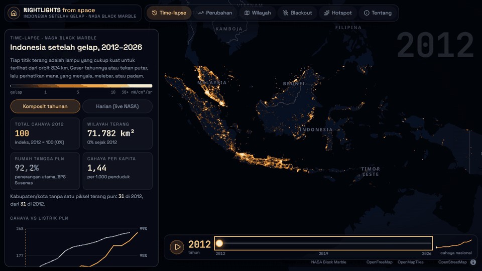
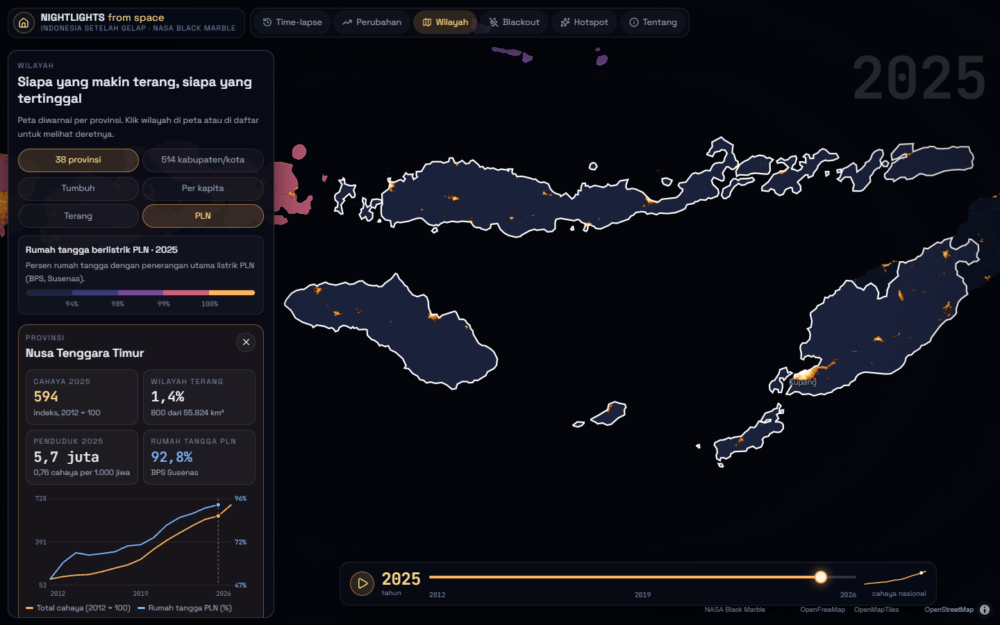
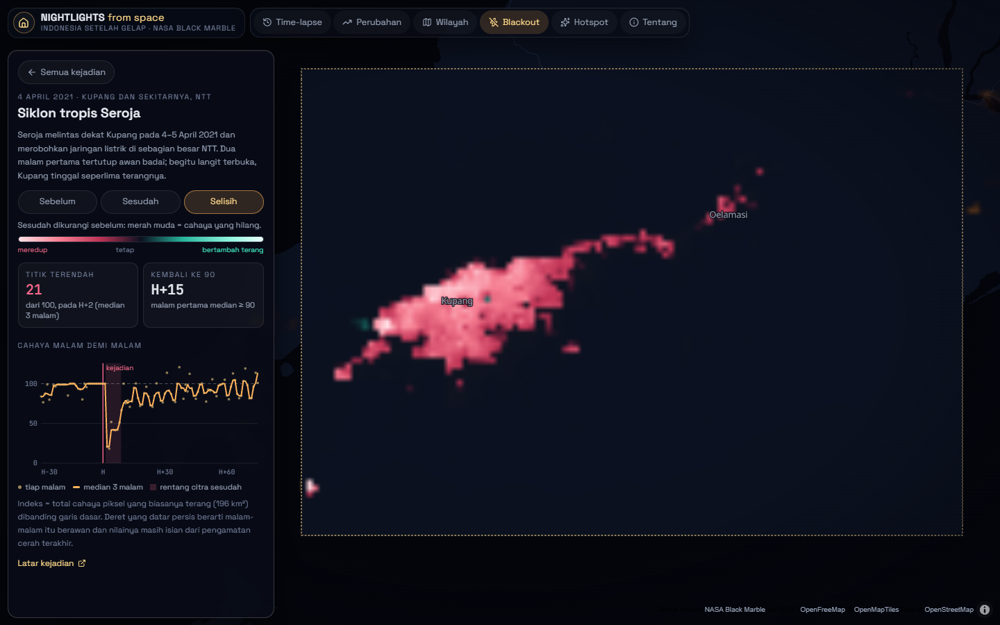
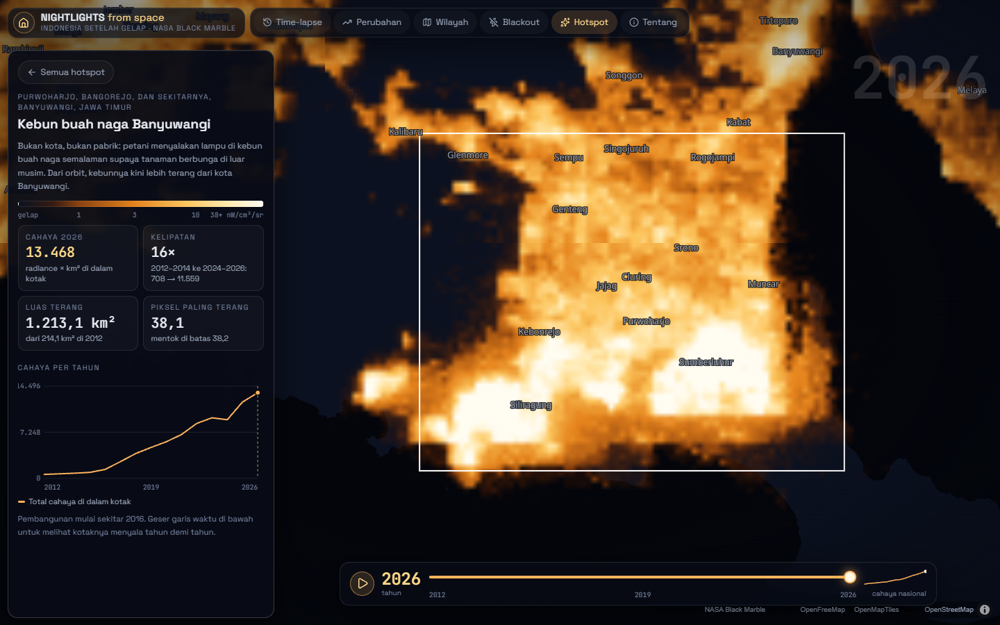
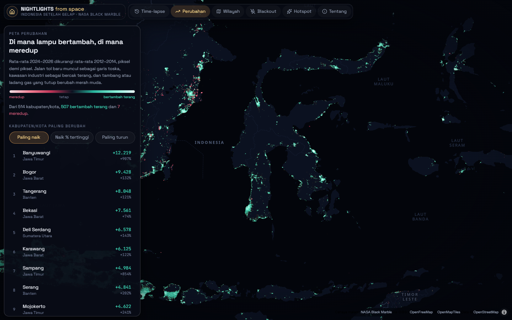

# Nightlights from Space

[](https://github.com/Avalon2222/nightlights-from-space/actions/workflows/ci.yml)
[](https://nextjs.org)
[](https://maplibre.org)
[](https://blackmarble.gsfc.nasa.gov/)
[](LICENSE)

> **Fifteen years of Indonesia after dark, seen from orbit.**
> Tiap malam sekitar pukul 01.30, satelit Suomi NPP lewat 824 km di atas Nusantara dan memotret lampunya. Repo ini
> menyusun 15 tahun potret itu jadi time-lapse yang bisa digeser, lalu menghitungnya: siapa yang makin terang, siapa yang
> masih gelap, kapan lampu padam setelah bencana, dan di mana sebuah kota atau smelter tiba-tiba muncul dari hutan.

**Live:** https://nightlights-from-space.vercel.app



<p align="center">
  
  
</p>

## 🇬🇧 In English

**An interactive night-lights atlas of Indonesia, 2012–2026, built from NASA Black Marble (VIIRS Day/Night Band).**
Fifteen annual composites are pre-rendered as transparent raster tiles and cross-faded in MapLibre, so the time-lapse
stays smooth on a phone. On top of the imagery sits an analysis layer computed from the same pixels:

- **Time-lapse** with a year slider and play button, plus a **live daily mode**: pick any date since 19 January 2012 and the
  tiles are fetched straight from NASA GIBS and recoloured in the browser.
- **Change map**: mean of 2024–2026 minus mean of 2012–2014, pixel by pixel. New toll roads show up as teal lines, closed
  mines turn pink.
- **Regions**: light growth, light per capita and lit-area share for all 38 provinces and 514 regencies/cities, next to
  the share of households lit by PLN (BPS), population and GRDP.
- **Blackouts**: nightly light index around six disasters and outages (Seroja 2021, the 2025 Sumatra floods, Lombok and
  Palu 2018, the 2019 Java blackout, Cianjur 2022) with before/after/difference imagery. Some are obvious from orbit,
  some are invisible, and the app says which.
- **Hotspots**: places that switched on, such as the new capital IKN, nickel smelters in Morowali and Weda Bay, and the
  lamp-lit dragon fruit farms of Banyuwangi.

No account or API key anywhere in the pipeline. Next.js 16, TypeScript, Tailwind 4, MapLibre GL; data prepared with
Python (NumPy + Pillow). Tested at 360, 390, 412 and 1440 px. *The rest of this README is in Indonesian.*

## Yang kelihatan dari data

Angka di bawah dihitung dari komposit di repo ini (lihat [metodologi](#metodologi) dan [batasannya](#batasan)).

| | 2012 | 2026 |
|---|---|---|
| Total cahaya nasional (indeks) | 100 | **280** |
| Wilayah terang | 52.685 km² | **134.290 km²** |
| Kabupaten/kota tanpa satu piksel terang pun | 37 | **10** (semuanya di pegunungan Papua) |
| Rumah tangga berpenerangan listrik PLN (BPS) | 92,2% | 98,5% (2025) |

- **Sambungan listrik sudah jenuh, cahaya belum.** Angka PLN naik enam poin, cahayanya hampir tiga kali lipat. Di 21
  provinsi yang sudah di atas 98% tersambung pun, cahaya per kapita masih terpaut sampai 4,7 kali. Korelasi peringkat
  antara persen PLN dan cahaya per kapita tinggal 0,28.
- **Timur mengejar.** Maluku Utara naik 822% (nikel), NTT 425%, Sulawesi Tenggara 423%, Sulawesi Tengah 375%.
  Jakarta cuma 19%, sebagian karena intinya sudah mentok di batas ukur.
- **Cahaya mengikuti ekonomi.** Total cahaya dan PDRB 38 provinsi berkorelasi 0,92 (log-log), dengan elastisitas 0,77.
- **IKN** naik 137 kali sejak konstruksi mulai 2022. **IMIP Morowali** 56 kali. Kebun **buah naga Banyuwangi**, yang
  dilampui semalaman supaya berbunga di luar musim, sekarang lebih terang dari kotanya.
- **Seroja, April 2021:** begitu awan badai lewat, Kupang tinggal 21% terangnya, dan baru kembali ke 90% dua minggu
  kemudian. **Cianjur 2022** nyaris tidak meninggalkan jejak: musim hujan, awan menutup hampir tiap malam.

<p align="center">
  
  
</p>

## Mode

| Mode | Isinya |
|---|---|
| **Time-lapse** | Komposit tahunan 2012–2026 dengan slider dan tombol putar (`spasi`), atau citra harian live dari NASA untuk tanggal mana pun. |
| **Perubahan** | Selisih 2024–2026 terhadap 2012–2014 per piksel, plus daftar kabupaten/kota yang paling naik dan paling turun. |
| **Wilayah** | Peta 38 provinsi atau 514 kabupaten/kota dengan empat metrik, pencarian, peringkat, deret per wilayah, dan dua grafik sebar (PLN vs cahaya, PDRB vs cahaya). |
| **Blackout** | Enam kejadian dengan citra sebelum, sesudah, dan selisih, deret cahaya harian H−30 sampai H+75, titik terendah, dan hari pulih. |
| **Hotspot** | Dua belas titik pembangunan dengan deret tahunan dan kelipatan cahayanya. |
| **Tentang** | Metodologi, sumber, dan batasan, langsung di dalam aplikasi. |

Semua tampilan tersimpan di URL (mode, tahun, wilayah, kejadian, posisi kamera), jadi tinggal salin tautannya untuk
dibagikan. Contoh: [`#m=hotspot&s=ikn`](https://nightlights-from-space.vercel.app/#m=hotspot&s=ikn),
[`#m=blackout&k=seroja-2021&v=selisih`](https://nightlights-from-space.vercel.app/#m=blackout&k=seroja-2021&v=selisih).

## Metodologi

1. **Citra.** [NASA Black Marble](https://blackmarble.gsfc.nasa.gov/) VNP46A2: radiance malam harian dari VIIRS
   Day/Night Band yang sudah dikoreksi cahaya bulan, atmosfer, dan sudut pandang, lalu diisi-celah saat berawan. Diambil
   dari [NASA GIBS](https://www.earthdata.nasa.gov/engage/open-data-services-software/earthdata-developer-portal/gibs-api)
   sebagai ubin PNG berpalet di zoom 8 (sekitar 600 m per piksel). Tiap indeks palet dikembalikan ke nW/cm²/sr lewat
   colormap resminya.
2. **Komposit tahunan.** Dua malam per bulan (tanggal 6 dan 21), 24 sampel per tahun, lalu median per piksel. Median
   membuang cahaya sesaat: kebakaran lahan, kapal, petir.
3. **Koreksi latar.** Rata-rata radiance daratan yang selalu gelap (89% daratan) mestinya nol, tapi bergeser 0,06–0,21
   dari tahun ke tahun. Angka itu dikurangkan per tahun supaya piksel redup tidak lompat ambang gara-gara derau.
4. **Statistik.** Piksel disebut terang kalau radiansnya ≥ 1 nW/cm²/sr. *Total cahaya* = jumlah radiance × luas piksel
   terang. Batas kabupaten/kota dilebarkan sekitar 2 km ke laut supaya cahaya kota pesisir tidak terbuang; provinsi =
   jumlah kabupatennya. Enam provinsi di Papua dihitung dengan batas sekarang untuk semua tahun.
5. **Kejadian.** Indeks harian = total cahaya piksel yang biasanya terang dibanding median 30 malam sebelumnya, diringkas
   dengan median geser 3 malam.
6. **Ubin.** Komposit diwarnai dengan satu palet (`data/palet.json`, dipakai Python dan TypeScript sekaligus), dipotong
   jadi PNG berpalet transparan zoom 2–8. Sekitar 3,6 MB per tahun.

## Batasan

- GIBS memotong radiance di **38,2 nW/cm²/sr**. Inti Jakarta dan Surabaya sudah mentok sejak 2012, jadi pertumbuhan
  cahayanya terhitung terlalu kecil. Luas terang tidak terpengaruh.
- **Cahaya bukan listrik rumah tangga.** Lampu jalan, pabrik, pelabuhan, tambang, suar gas, dan kebun buah naga ikut
  terhitung; desa yang baru tersambung dengan beberapa lampu redup bisa tetap di bawah ambang.
- Lampu jalan **LED putih** kurang terlihat oleh sensor VIIRS yang tidak peka biru. Sebagian "meredup" berasal dari sini.
- Satelit lewat sekitar **01.30** dan tidak menembus awan. Padam singkat (blackout Jawa 2019) atau padam di musim hujan
  (Cianjur 2022) sering lolos, dan produk isi-celah menampilkan pengamatan cerah terakhir.
- Persen PLN dari BPS adalah **survei rumah tangga** (Susenas), bukan rasio elektrifikasi versi Kementerian ESDM.
- 2012 mulai 19 Januari; tahun berjalan baru sampai tanggal sampel terakhir.

## Sumber data

Rinciannya, termasuk tanggal unduh dan lisensi, ada di [`data/SUMBER_DATA.md`](data/SUMBER_DATA.md).

| Data | Sumber |
|---|---|
| Cahaya malam harian | NASA Black Marble VNP46A2 lewat NASA GIBS |
| Batas 514 kabupaten/kota | BPS lewat OCHA/HDX dan geoBoundaries (CC BY 3.0 IGO) |
| Rumah tangga berlistrik PLN 2012–2025 | BPS, Susenas |
| Penduduk | BPS: Sensus 2010, Sensus 2020, proyeksi 2025; kabupaten/kota dari COD-PS 2020 (UNFPA/HDX) |
| PDRB provinsi | BPS, seri 2010 |
| Peta dasar | OpenStreetMap lewat OpenFreeMap |

## Struktur

```
scripts/     pipeline Python: unduh GIBS, komposit, statistik, ubin, kejadian
data/        CSV hasil olahan + konfigurasi kejadian, hotspot, dan palet
public/      ubin PNG per tahun, citra kejadian, JSON ringkas untuk aplikasi
src/lib/     logika murni: hitungan, metrik, palet, URL, protokol GIBS, kendali peta
src/components/  panel tiap mode, garis waktu, grafik SVG
tests/       Vitest (unit + validasi data), Playwright (4 ukuran layar), pytest (pipeline)
```

## Jalankan di lokal

```bash
npm install
npm run dev          # http://localhost:3000
```

```bash
npm run typecheck && npm run lint && npm test
npm run build && npm run test:e2e
```

Build memakai `next build --webpack`. Tidak ada variabel lingkungan yang perlu diisi.

## Bangun ulang datanya

Semua data di `public/` sudah ikut di repo, jadi langkah ini hanya untuk memperbarui. Butuh Python 3.12+ dan sekitar
1,5 GB ruang untuk cache ubin mentah.

```bash
pip install -r scripts/requirements.txt
python scripts/wilayah.py          # batas kabupaten + raster label
npx mapshaper cache/olah/kab_mentah.geojson -simplify 12% keep-shapes -clean -o precision=0.001 public/data/kabupaten.geojson -dissolve kode_prov copy-fields=provinsi -rename-fields kode=kode_prov,nama=provinsi -o precision=0.001 public/data/provinsi.geojson
python scripts/pembanding.py       # PLN, penduduk, PDRB
python scripts/ambil_tahunan.py    # unduh ubin GIBS dan bikin komposit (sekitar 40 menit untuk 15 tahun)
python scripts/latar.py            # tingkat latar per tahun
python scripts/statistik.py        # cahaya per kabupaten, provinsi, nasional
python scripts/ubin.py             # ubin PNG per tahun + peta selisih
python scripts/kejadian.py         # deret harian dan citra kejadian
python scripts/bangun_data.py      # JSON untuk aplikasi
```

Untuk menambah tahun berjalan cukup `python scripts/ambil_tahunan.py --dari 2026 --ulang`, lalu jalankan lagi empat
skrip terakhir. Menambah kejadian atau hotspot baru = menambah satu entri di `data/kejadian.json` atau
`data/sorotan.json`.

## Lisensi

Kode berlisensi [MIT](LICENSE). Citra Black Marble adalah data NASA dan bebas dipakai dengan atribusi. Batas wilayah
CC BY 3.0 IGO. Peta dasar © kontributor OpenStreetMap.
